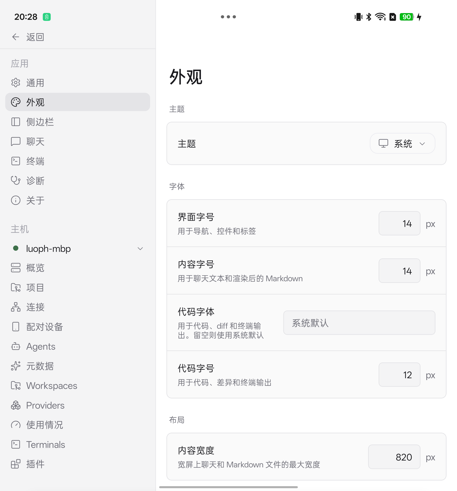

# Android tablet layout QA

Patch branch: `luoph/paseo:fix/android-pad-layout`
Base: `c1558d29eab78c898743adb613afa01ba4f0e780`
Validated source: `5fbd9c41472606b62eebf64541dfb651e3cb604b`

## Device observations

OPPO PHN110 foldable, Android 16, unfolded display 2268 x 2440 physical pixels, density 520 dpi. Portrait viewport approximately 698 x 751 dp.

Before: the 698 dp viewport fell below the old 720 dp `md` breakpoint, selecting the compact phone shell. Unlocking orientation alone did not fix the portrait layout.
After the local layout patch: pinned navigation appeared in portrait; the touch grip was visible, dragging in both directions changed the sidebar width, and a process restart retained the saved width. Opening Settings used the saved navigation width instead of a fixed 320 dp list; the outer navigation yielded when both lists and 400 dp details would not fit.

The screenshot is from that earlier device build on base `6017706cc147ae64c7b0f0a31fa94e304912b364`, before rebasing this focused patch onto current main. It is **not** a device screenshot of the final PR head. The device has user-selected 14/14 font sizes and the earlier local build unlocked orientation; neither font-default changes nor orientation changes are included in this PR. The final branch has automated checks below; it has not been rebuilt/reinstalled on the device.



## Automated verification

Commands were run from the isolated PR checkout, with Vitest run from `packages/app`.

- `npm run build:server`: passed (refresh workspace declarations before typecheck).
- `npm run format`: passed.
- `npm run lint`: passed; final changed-file commit hook also passed.
- `npm run typecheck`: passed across workspaces; final commit hook also passed.
- `npx vitest run src/components/desktop-sidebar-layout.test.ts src/styles/breakpoints.test.ts --bail=1`: 19 passed.
- Regression check using the old `md: 720` policy: fails at 600 dp, expected non-compact but received compact.
- Regression check using the baseline sidebar helper and layout constants: fails at 698 dp with a 240 dp saved sidebar, expected settings content minimum 640 but received 720.

The breakpoint test exercises the real exported table consumed by Unistyles and the actual compact predicate. It does not emulate Unistyles' native runtime. No per-test module mocks.

## Platform coverage and remaining manual QA

| Platform | Covered | Limits |
| --- | --- | --- |
| Android | Local foldable build, manual layout/drag/persistence/settings checks; final head static/unit checks | Final head not installed; folding/unfolding transition and landscape not recorded |
| iOS / iPad | No | Shared 600-719 dp breakpoint and settings width need device/simulator QA |
| Browser web | No | Narrow window breakpoint and settings width need real-browser QA |
| Electron macOS / Windows / Linux | No | Narrow window breakpoint and settings width need wrapper QA |

The shared `md` threshold changes all responsive `md` styles from 720 to 600. No native orientation policy, pane splitting capability, protocol, daemon, or font defaults are changed.

## Raw focused test output

```text

 RUN  v4.1.7 /Users/luopeihuan/workspace/rrd/paseo/.worktrees/android-pad-layout/packages/app


 Test Files  2 passed (2)
      Tests  19 passed (19)
   Start at  21:18:56
   Duration  639ms (transform 775ms, setup 41ms, import 1.04s, tests 3ms, environment 0ms)


```

## Raw breakpoint regression output (old width policy)

```text

 RUN  v4.1.7 /Users/luopeihuan/workspace/rrd/paseo/.worktrees/android-pad-layout/packages/app

 ❯ |unit| src/styles/breakpoints.test.ts (6 tests | 1 failed) 3ms
     × uses the expected form factor at 600 dp 2ms

⎯⎯⎯⎯⎯⎯⎯ Failed Tests 1 ⎯⎯⎯⎯⎯⎯⎯

 FAIL  |unit| src/styles/breakpoints.test.ts > responsive form factor > uses the expected form factor at 600 dp
AssertionError: expected true to be false // Object.is equality

- Expected
+ Received

- false
+ true

 ❯ src/styles/breakpoints.test.ts:17:50
     15|
     16|     expect(breakpoint).toBeDefined();
     17|     expect(isCompactBreakpoint(breakpoint?.[0])).toBe(compact);
       |                                                  ^
     18|   });
     19| });

⎯⎯⎯⎯⎯⎯⎯⎯⎯⎯⎯⎯⎯⎯⎯⎯⎯⎯⎯⎯⎯⎯⎯⎯[1/1]⎯


 Test Files  1 failed (1)
      Tests  1 failed | 2 passed (6)
   Start at  21:16:41
   Duration  397ms (transform 245ms, setup 17ms, import 321ms, tests 3ms, environment 0ms)

```

## Raw settings regression output (baseline helpers)

```text

 RUN  v4.1.7 /Users/luopeihuan/workspace/rrd/paseo/.worktrees/android-pad-layout/packages/app

 ❯ |unit| src/components/desktop-sidebar-layout.test.ts (13 tests | 1 failed) 4ms
     × reserves the shared sidebar width and settings detail at 698 px 2ms

⎯⎯⎯⎯⎯⎯⎯ Failed Tests 1 ⎯⎯⎯⎯⎯⎯⎯

 FAIL  |unit| src/components/desktop-sidebar-layout.test.ts > desktop sidebar layout > reserves the shared sidebar width and settings detail at 698 px
AssertionError: expected 720 to be 640 // Object.is equality

- Expected
+ Received

- 640
+ 720

 ❯ src/components/desktop-sidebar-layout.test.ts:124:35
    122|       });
    123|
    124|       expect(contentMinimumWidth).toBe(settingsMinimum);
       |                                   ^
    125|       expect(
    126|         canDesktopAppSidebarShare({ contentMinimumWidth, requestedSide…

⎯⎯⎯⎯⎯⎯⎯⎯⎯⎯⎯⎯⎯⎯⎯⎯⎯⎯⎯⎯⎯⎯⎯⎯[1/1]⎯


 Test Files  1 failed (1)
      Tests  1 failed | 7 passed (13)
   Start at  21:16:57
   Duration  444ms (transform 273ms, setup 18ms, import 368ms, tests 4ms, environment 0ms)

```
